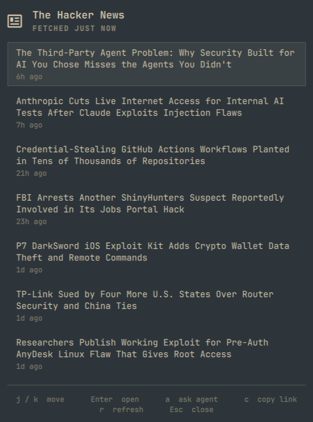

# The Hacker News

Lists recent headlines from The Hacker News in the Omarchy bar.



## Why

A way to skim security headlines from the bar without opening a browser.
Fetching is on demand — nothing is fetched on open and there is no background
polling, so the widget stays silent until you ask.

## How it works

1. The widget is a bar-widget plugin loaded by `omarchy-shell` at startup from
   `Panel.qml`. It holds no data and never talks to the network on its own.
2. Pressing `r` (or sending the IPC `refresh` command) runs the bundled
   `thn-fetch.sh`, which fetches the feed over HTTPS with `curl` pinned to
   `--proto '=https' --proto-redir '=https' --tlsv1.2`.
3. The raw response is piped through `normalize.jq`, which extracts
   title, URL, published time, tags, and summary from the Blogger/Atom feed and
   strips the HTML to plain text.
4. The result is written atomically to a cache in `~/.cache/omarchy-hackernews/`
   and printed as a single JSON line, capped at `maxItems` entries. If the
   network or parse fails, the last cached copy is served with a `stale` flag.
5. Back in the panel, `Model.js` parses that line and sanitizes every field —
   control characters are removed, values are length-capped, and only `http(s)`
   URLs survive — before the list is rendered with `Text.PlainText`.
6. User actions go through `Util.execArgv` (no shell involved), so feed data is
   passed as argv and never re-tokenized.

## Usage

| Key            | Action                         |
| -------------- | ------------------------------ |
| `j` / `Down`   | move down                      |
| `k` / `Up`     | move up                        |
| `Enter` / `o`  | open the selected story        |
| `a`            | ask your default agent         |
| `c`            | copy the selected link         |
| `r`            | refresh the feed               |
| `Esc`          | close                          |

`a` uses whatever agent you set with `omarchy default agent`.

## Installation

```bash
# This section will be filled when the plugin is released.
```

## License

This project is licensed under the [MIT License](LICENSE).