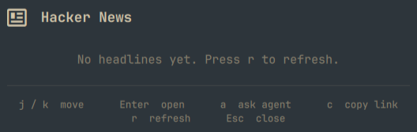

# Hacker News

Lists recent headlines from [The Hacker News](https://thehackernews.com) in the Omarchy bar.



## Why

Security moves fast, and what you miss can matter. This plugin keeps the latest
headlines one keypress away in the bar, so you can stay current between tasks
without opening a browser or keeping a news tab open. Whatever you last pulled
is saved locally and appears instantly when you open the panel, even offline.

## How it works

1. The widget is a bar-widget plugin loaded by `omarchy-shell` at startup from
   `Panel.qml`. It never talks to the network on its own; when the panel first
   opens it reads the last saved copy from the local cache, so headlines appear
   instantly even offline.
2. Pressing `r` (or sending the IPC `refresh` command) runs the bundled
   `thn-fetch.sh`, which fetches the feed over HTTPS with `curl` pinned to
   `--proto '=https' --proto-redir '=https' --tlsv1.2`.
3. The raw response is piped through `normalize.jq`, which extracts
   title, URL, published time, tags, and summary from the Blogger/Atom feed and
   strips the HTML to plain text.
4. The result is written atomically to a cache in `~/.cache/omarchy-hackernews/`
   and printed as a single JSON line, capped at `maxItems` entries. If the
   network or parse fails, the last cached copy is served with a `stale` flag.
5. Back in the panel, `Model.js` parses that line and sanitizes every field —
   control characters are removed, values are length-capped, and only `http(s)`
   URLs survive — before the list is rendered with `Text.PlainText`.
6. User actions go through `Util.execArgv` (no shell involved), so feed data is
   passed as argv and never re-tokenized.

## Usage

| Key            | Action                         |
| -------------- | ------------------------------ |
| `j` / `Down`   | move down                      |
| `k` / `Up`     | move up                        |
| `Enter` / `o`  | open the selected story        |
| `a`            | ask your default agent         |
| `c`            | copy the selected link         |
| `r`            | refresh the feed               |
| `Esc`          | close                          |

`a` uses whatever agent you set with `omarchy default agent`.

## Installation

**Requirements:** an [Omarchy](https://omarchy.org) install with an internet
connection. The fetch helper uses `curl` and `jq`.

```bash
omarchy plugin add https://github.com/batusaribay/omarchy-hackernews --enable
```

To remove:

```bash
omarchy plugin remove batusaribay.hackernews
```

The widget fetches nothing on its own; `~/.cache/omarchy-hackernews/` is only
written when you refresh with `r`, and is read back automatically when the panel
opens. Remove that folder to drop the stored copy.

## License

This project is licensed under the [MIT License](LICENSE).